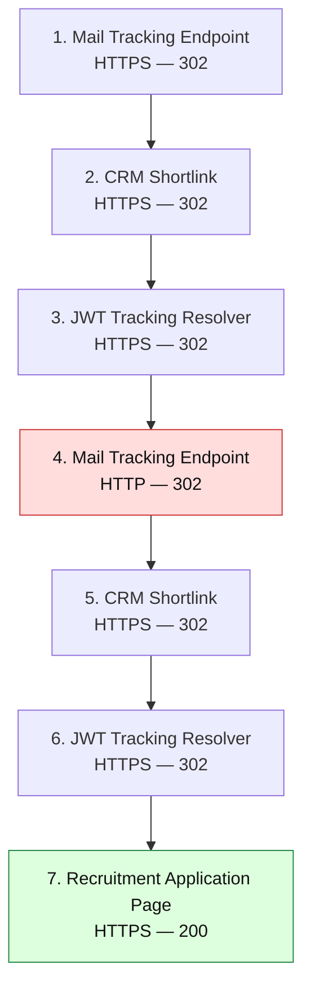

# Multi-Channel Social Engineering Investigation
### 7-Hop URL Forensics, JWT Analysis & PII Risk Assessment

**Author:** Axel Hinrichs  
**Date:** November 2, 2026  
**Focus Areas:** Threat Intelligence | Email & URL Forensics | GRC | Data Privacy  
**Tools Used:** VirusTotal, SafeToOpen, Gemini Argon  
**Final Disposition:** Suspected Recruitment Marketing Funnel — No Confirmed Malware; Privacy & Transport-Security Concerns

---

## Executive Summary

This case study documents an independent investigation into a suspicious recruitment campaign delivered through two communication channels: email and SMS.

The investigation began when an unsolicited recruitment email was automatically classified as spam by Gmail. Approximately eight minutes later, an SMS message instructed me to check my email, specifically directing me to my Spam folder.

This multi-channel communication pattern raised concerns about potential social engineering and attempts to circumvent email filtering.

Using a tiered investigative methodology, I performed:

1. **Static reputation analysis** using VirusTotal.
2. **Dynamic behavioral analysis** using SafeToOpen.
3. **AI-assisted redirect and token analysis** using Gemini Argon.
4. **PII risk assessment** examining contact information embedded in URLs.
5. **GRC analysis** mapping relevant findings to NIST SP 800-53 controls.

The investigation revealed a multi-domain redirect sequence, encoded campaign tracking metadata, an intermediate HTTP downgrade, and personal information embedded in the final destination's URL parameters.

**No malware execution was confirmed during the observed investigation.**

However, the identified privacy and transport-security concerns justified a risk-based decision to avoid the destination.

### Key Findings

| Finding | Description | Assessment |
|---|---|---|
| Multi-channel outreach | SMS encouraged interaction with an email classified as spam | Suspicious communication pattern |
| Redirect infrastructure | Six redirects across seven observed HTTP responses | Complex tracking architecture |
| HTTP downgrade | An intermediate redirect transitioned from HTTPS to HTTP | Potential transport-security weakness |
| JWT tracking | Encoded token contained contact and campaign metadata | CRM attribution behavior |
| PII in URL | Name, email, phone, and contact ID appeared in query parameters | Potential privacy exposure |
| Sandbox indicators | Verification interface and obfuscated/minified JavaScript reported | Requires contextual interpretation |
| Malware analysis | No confirmed malware execution in observed analysis | Maliciousness not established |

---

## 1. Investigation Objectives

The investigation sought to determine:

1. Whether the unsolicited recruitment campaign exhibited malicious behavior.
2. Which infrastructure and services processed the application link.
3. What information was contained within the encoded tracking URLs.
4. Whether the redirect chain introduced security or privacy risks.
5. What risk-based security disposition was appropriate.

### Skills Demonstrated

- Open-Source Intelligence (OSINT)
- Email and URL forensic analysis
- Static reputation triage
- Dynamic sandbox investigation
- HTTP redirect chain reconstruction
- JWT decoding and payload inspection
- Encoded URL analysis
- Personally Identifiable Information (PII) assessment
- NIST SP 800-53 control mapping
- Risk-based decision-making
- Technical documentation and evidence evaluation

---

## 2. Case Origin: Multi-Channel Social Engineering Indicators

### Initial Email

**Sender:** `john@mail.ailifecareer.com`  
**Subject:** `RE: We're interested in hiring you!`  
**Received:** November 2, 2026, approximately 09:08 AM CST  
**Classification:** Gmail Spam

The email advertised a recruitment opportunity and directed the recipient toward an external application page.

### Follow-Up SMS

At approximately 09:16 AM CST, an SMS instructed me to check my email, including the Spam folder.

This was noteworthy because the message encouraged interaction with content already filtered by the email provider.

Although this could represent an attempt to circumvent email security filtering, the available evidence does not establish the sender's intent.

### Initial Indicators

| Indicator | Observation | Security Interpretation |
|---|---|---|
| Unsolicited recruitment | No established prior correspondence | Increased social engineering suspicion |
| `RE:` subject prefix | Reply-style subject without known preceding conversation | Possible fabricated familiarity |
| Spam-folder instruction | SMS directed attention to filtered email | Potential filtering circumvention |
| External application link | Required navigation to a separate website | Expanded trust boundary |
| No-phone-call preference | Email discouraged telephone communication | Reduced direct verification opportunity |
| Tracking infrastructure | Multiple redirects and encoded parameters | Required further investigation |

**Initial Assessment:** Suspicious unsolicited recruitment outreach.

---

## 3. Investigation Timeline

All local timestamps use Central Standard Time (CST, UTC−06:00).

| Time (CST) | Event | Evidence |
|---|---|---|
| 09:08:46 AM | Timestamp represented by decoded JWT `sentAt` | JWT payload |
| 09:08 AM | Recruitment email received and classified as spam | Gmail |
| 09:16 AM | SMS instructed recipient to check Spam folder | SMS record |
| 10:22 AM | Static reputation investigation | VirusTotal |
| 10:26 AM | Dynamic behavioral investigation | SafeToOpen |
| 10:30 AM | Redirect and token analysis | Gemini Argon |

**Timestamp clarification:** The JWT value `1793632126974` corresponds to approximately 09:08:46 AM CST on November 2, 2026.

The `sentAt` field does not independently establish the actual email dispatch time.

---

## 4. Tiered Investigation Methodology

### Phase I — Static Reputation Analysis

**Tool:** VirusTotal

**Target URL:**

```text
http://email.mail.ailifecareer.com/c/eJxslEuT...
```

**Reported Resolved IP:**

```text
34.110.180.34
```

### Findings

The recorded VirusTotal report indicated:

- Aggregate detection score: `0/93`
- Gridinsoft reportedly classified the URL as suspicious.
- The aggregate result did not establish confirmed malicious activity.

The original report should be retained to clarify the relationship between the aggregate score and individual vendor classifications.

### Analytical Decision

A low detection score does not guarantee that a destination is safe.

The initial URL was a tracking endpoint, potentially leading to additional infrastructure beyond the initially scanned address.

**Decision:** Escalate to dynamic behavioral analysis.

---

### Phase II — Dynamic Behavioral Analysis

**Tool:** SafeToOpen

**Reported Verdict:** `Suspicious`

The sandbox reported three notable behaviors.

#### Finding A — Human-Verification Interface

SafeToOpen identified a suspicious human-verification interface.

Such interfaces may serve legitimate access-control purposes or complicate automated inspection.

The investigation did not independently establish that the interface was designed to evade security tools.

#### Finding B — JavaScript Obfuscation Indicators

The sandbox reported:

- Obfuscation score: `70/100`
- One heavily transformed JavaScript file
- Webpack/Terser-related patterns

Webpack and Terser are widely used for legitimate production JavaScript.

Their presence alone does not demonstrate malicious obfuscation or anti-analysis behavior.

#### Finding C — Multi-Domain Redirects

The sandbox identified three domains involved in the redirect sequence:

```text
email.mail.ailifecareer.com
go.agentbase.io
younggroup.ailifecareer.com
```

The sequence included repeated tracking endpoints and an intermediate transition to HTTP.

**Decision:** Reconstruct the redirect sequence and inspect encoded tracking metadata.

---

## 5. Redirect Chain Forensic Reconstruction

### Redirect Flow Diagram



**Legend:**

- Red: HTTP transport-security concern
- Green: Final landing page
- Other nodes: Tracking and routing infrastructure

### Redirect Details

| Hop | HTTP Status | Endpoint | Forensic Interpretation |
|---|---|---|---|
| 1 | 302 | `https://email.mail.ailifecareer.com/c/...` | Initial mail-tracking wrapper |
| 2 | 302 | `https://go.agentbase.io/l/...` | CRM-style campaign shortlink |
| 3 | 302 | `https://go.agentbase.io/r/2/...` | JWT-based attribution resolver |
| 4 | 302 | `http://email.mail.ailifecareer.com/c/...` | Intermediate HTTP downgrade |
| 5 | 302 | `https://go.agentbase.io/l/...` | Repeated tracking endpoint |
| 6 | 302 | `https://go.agentbase.io/r/2/...` | Repeated JWT routing |
| 7 | 200 | `https://younggroup.ailifecareer.com/application-page?...` | Final recruitment destination |

**Technical clarification:** The observed sequence contains six redirects and seven HTTP responses, including the final `200 OK`.

The exact sequence should be verified against the retained sandbox network log.

---

## 6. Finding F-01: HTTP Protocol Downgrade

### Observation

At Hop 4, the redirect sequence transitioned from HTTPS to HTTP.

```text
HTTPS → HTTPS → HTTPS → HTTP → HTTPS → HTTPS → HTTPS
```

HTTP does not provide the confidentiality and integrity protections of HTTPS.

If the HTTP request carried sensitive information, an observer with appropriate network visibility could potentially inspect that information.

### Security Impact

Potential risks include:

- Exposure of information transmitted over HTTP.
- Modification of unprotected HTTP responses.
- Reduced integrity of the redirect process.
- Increased reliance on subsequent secure connections.

### Evidence Limitation

The observed HTTP transition does not independently prove that personal information was transmitted in cleartext.

Confirming actual exposure requires examining the request URL, headers, and transmitted data.

**Assessment:** Potential transport-security weakness.

**Relevant Control:** NIST SP 800-53 SC-8 — Transmission Confidentiality and Integrity.

---

## 7. Finding F-02: Repeated Tracking Infrastructure

The redirect chain passed through the same mail-tracking and CRM-style endpoints more than once.

### Observation

```text
Mail Tracking
    ↓
CRM Shortlink
    ↓
JWT Resolver
    ↓
Mail Tracking
    ↓
CRM Shortlink
    ↓
JWT Resolver
    ↓
Application Page
```

### Interpretation

The repeated routing may result from nested tracking wrappers or redundant campaign link processing.

This complexity can make the final destination less transparent during basic URL inspection.

However, the repetition does not establish:

- Malicious activity.
- Duplicate tracking events.
- Intentional evasion.
- Unauthorized data collection.

**Assessment:** Tracking complexity and reduced destination transparency.

---

## 8. JWT & Encoded Payload Analysis

### JWT Header

The redirect URL contained a JWT declaring the HS256 algorithm.

```json
{
  "alg": "HS256"
}
```

### Sanitized JWT Payload

```json
{
  "link_id": "[REDACTED]",
  "sentAt": 1793632126974,
  "contact_id": "[REDACTED]",
  "messageType": "email",
  "messageId": "[REDACTED]",
  "workflow_status_id": "[REDACTED]",
  "domain": "go.agentbase.io"
}
```

### Field Interpretation

| Field | Likely Function |
|---|---|
| `link_id` | Identifies a campaign link |
| `sentAt` | Records a message-related timestamp |
| `contact_id` | Associates activity with a contact record |
| `messageType` | Identifies the communication channel |
| `messageId` | Associates activity with a specific message |
| `workflow_status_id` | References a workflow state or record |
| `domain` | Identifies the routing domain |

The structure is consistent with automated CRM campaign tracking.

### Cryptographic Considerations

A JWT consists of three components:

```text
HEADER.PAYLOAD.SIGNATURE
```

The header and payload are typically Base64URL encoded, not encrypted.

Their contents can generally be decoded without possessing the signing secret.

**Important:** Decoding a JWT does not validate its signature.

The investigation identified an HS256 algorithm declaration but did not independently verify signature validity.

### Encoded Mail Tracking Wrapper

The initial tracking URL contained a long encoded segment.

AI-assisted analysis suggested a Base64URL-compatible representation with possible zlib-compressed content.

A potential zlib header was identified:

```text
0x78 0x9c
```

However, the exact encoding structure and cryptographic signature scheme require independent validation.

**Assessment:** Encoded campaign-routing information consistent with tracking infrastructure.

---

## 9. Finding F-03: PII Embedded in URL Query Parameters

### Observed Destination Structure

The final application URL contained parameters resembling:

```text
https://younggroup.ailifecareer.com/application-page
    ?ghl_contact_id=[REDACTED]
    &first_name=[REDACTED]
    &last_name=[REDACTED]
    &email=[REDACTED]
    &phone=[REDACTED]
```

### Identified Data Categories

| Parameter | Data Type | Privacy Concern |
|---|---|---|
| `first_name` | Personal information | Identity association |
| `last_name` | Personal information | Identity association |
| `email` | Contact information | Unsolicited contact and profiling |
| `phone` | Contact information | Contact correlation |
| `ghl_contact_id` | Persistent identifier | CRM record correlation |

### Security Interpretation

The final destination used HTTPS, meaning the URL path and query string were generally protected during transmission to the HTTPS endpoint.

However, embedding personal information directly into URLs creates potential secondary disclosure risks.

These include:

1. Browser history.
2. Copied or shared URLs.
3. Web server and application logs.
4. Analytics and monitoring systems.
5. Referrer headers, depending on browser and site policies.
6. Screenshots and support records.

The investigation did not confirm unauthorized disclosure through any of these mechanisms.

### Recommended Mitigations

- Avoid embedding personal information in URL query parameters.
- Use opaque, short-lived identifiers where appropriate.
- Resolve contact information server-side.
- Enforce HTTPS across all redirects.
- Minimize sensitive URL logging.
- Review referrer policies.
- Limit unnecessary collection and retention of tracking data.

**Assessment:** Potential privacy exposure resulting from PII-bearing URL parameters.

---

## 10. Governance, Risk & Compliance Assessment

The investigation's findings were mapped to selected NIST SP 800-53 Rev. 5 controls.

This mapping identifies relevant security and privacy considerations. It does not establish formal compliance failures.

| Finding | NIST Control | Control Objective |
|---|---|---|
| HTTP downgrade | SC-8 | Transmission Confidentiality and Integrity |
| PII processing | PT-2 | Authority to Process Personally Identifiable Information |
| Campaign tracking | PT-3 | Personally Identifiable Information Processing Purposes |
| Sensitive URL retention | SI-12 | Information Management and Retention |
| Social engineering indicators | AT-2 | Literacy Training and Awareness |

### Privacy Regulation Considerations

The identified PII-handling practices may warrant additional evaluation under applicable privacy regulations, including:

- General Data Protection Regulation (GDPR)
- California Consumer Privacy Act (CCPA/CPRA)

Regulatory applicability depends on jurisdiction, the organizations involved, processing purposes, and other legal factors.

**No regulatory violation was established during this investigation.**

---

## 11. Preliminary Risk Register

The following ratings are qualitative analyst estimates rather than confirmed measures of exploitation.

| Risk ID | Scenario | Likelihood | Impact | Preliminary Rating |
|---|---|---|---|---|
| R-01 | Sensitive information potentially transmitted through HTTP | Conditional | Moderate | Medium |
| R-02 | PII-bearing URLs retained by secondary systems | Plausible | Moderate | Medium |
| R-03 | Unsolicited outreach encourages interaction with unverified infrastructure | Plausible | Moderate | Medium |
| R-04 | Complex tracking obscures destination transparency | Observed complexity | Low–Moderate | Low–Medium |

These ratings would require refinement using an established organizational risk methodology and additional evidence.

### Selected Risk Treatment

**Risk Avoidance**

I chose not to engage with the recruitment application.

This decision was based on:

- Unsolicited multi-channel outreach.
- An email classified as spam.
- Complex tracking infrastructure.
- An intermediate HTTP redirect.
- Personal contact information embedded in URL parameters.

The decision did not require definitive proof of malicious intent.

---

## 12. Evidence Confidence Assessment

| Finding | Evidence | Confidence |
|---|---|---|
| Email and SMS were received | Recipient records | High |
| Email was classified as spam | Gmail | High |
| Multi-domain redirects were reported | SafeToOpen | High for reported behavior |
| JWT contained campaign metadata | Decoded token | High for decoded content |
| JWT signature was valid | Not verified | Not Established |
| HTTP appeared in redirect chain | Sandbox report | High for reported behavior |
| PII appeared in URL parameters | Captured destination URL | High |
| Unauthorized PII disclosure occurred | No confirming evidence | Not Established |
| Campaign intentionally evaded security controls | Behavioral interpretation | Unconfirmed |
| Malware was delivered | No confirming evidence | Not Established |

---

## 13. Investigation Limitations

The investigation did not include:

- Independent JWT signature verification.
- Complete source-code analysis of the landing page.
- Access to campaign backend systems.
- Confirmation of unauthorized PII disclosure.
- Independent validation of every infrastructure-provider attribution.
- Evidence establishing malicious intent.
- Comprehensive testing of all possible landing-page behaviors.

AI-assisted analysis was used to accelerate interpretation of captured data.

AI-generated conclusions were not treated as independent forensic proof.

---

## 14. Final Investigation Disposition

### Classification

**Suspected Unsolicited Recruitment Marketing Funnel**

### Malware Status

**No confirmed malware execution during observed analysis.**

### Security Findings

- Intermediate HTTP redirect.
- Repeated tracking infrastructure.
- Encoded campaign attribution metadata.
- PII embedded in destination URL query parameters.

### Final Decision

**Avoided due to privacy and transport-security concerns.**

### Analyst Conclusion

The investigation demonstrated that suspicious communications should not be evaluated solely through a malicious-versus-benign classification.

Although the observed infrastructure was consistent with an automated recruitment marketing workflow, the investigation identified privacy and transport-security concerns that warranted further assessment.

The most significant findings were an intermediate HTTP redirect and the inclusion of personal contact information in the final URL.

Neither finding independently established exploitation, unauthorized disclosure, or malicious intent.

Nevertheless, the combination of unsolicited outreach, tracking complexity, and potential privacy risks supported a proportionate decision to avoid the destination.

**The central lesson of this case is that effective security analysis evaluates observed behavior, evidence quality, uncertainty, and potential impact rather than relying exclusively on automated malware detection scores.**

---

## 15. Lessons Learned

### 1. Reputation Scores Are Not Definitive

Static scanners provide valuable indicators but may not fully represent downstream redirect behavior.

### 2. Dynamic Analysis Provides Additional Context

Sandboxing exposed redirect behavior and page characteristics that were not apparent from the initial URL.

### 3. Encoded Tracking Tokens Reveal Infrastructure Behavior

JWT inspection provided insight into campaign metadata and automated contact attribution.

### 4. Privacy Risks Can Exist Without Malware

Sensitive information in URL parameters can introduce unnecessary disclosure opportunities even when the final connection uses HTTPS.

### 5. Evidence Must Be Separated From Interpretation

Automated verdicts, AI-assisted analysis, and behavioral indicators require contextual evaluation and independent validation.

### 6. Security Decisions Should Be Risk-Based

Avoiding an unverified destination can be justified by credible security and privacy concerns without proving malicious intent.

---

## 16. Evidence Artifacts

The following sanitized artifacts are intended for inclusion in the repository.

| ID | Artifact | Status |
|---|---|---|
| E-01 | Email message and header screenshot | Pending |
| E-02 | SMS screenshot | Pending |
| E-03 | VirusTotal scan report | Pending |
| E-04 | SafeToOpen behavioral report | Pending |
| E-05 | Redirect-chain network log | Pending |
| E-06 | JWT decoding and timestamp notes | Pending |
| E-07 | Sanitized final destination URL | Pending |

> **Privacy Notice:** Contact information, campaign-specific tokens, and personal identifiers should be redacted before evidence is published.

---

## 17. Technical References

- [NIST SP 800-53 Rev. 5 — Security and Privacy Controls](https://csrc.nist.gov/pubs/sp/800/53/r5/upd1/final)
- [RFC 7519 — JSON Web Token (JWT)](https://www.rfc-editor.org/rfc/rfc7519)
- [RFC 9110 — HTTP Semantics](https://www.rfc-editor.org/rfc/rfc9110)
- [OWASP — Information Exposure Through Query Strings in URL](https://owasp.org/www-community/vulnerabilities/Information_exposure_through_query_strings_in_url)
- [MITRE ATT&CK — Phishing (T1566)](https://attack.mitre.org/techniques/T1566/)

---

## 18. Ethics & Responsible Analysis

This investigation was conducted for defensive cybersecurity education and independent risk assessment.

The analysis focused on communications received by the investigator and relied on third-party security tools, captured artifacts, and offline token inspection.

No attempt was made to gain unauthorized access, compromise infrastructure, or obtain unrelated individuals' information.

The findings should not be interpreted as proof of criminal conduct, malicious intent, or regulatory violations by the organizations referenced.

---

**Author:** Axel Hinrichs  
**Field:** Cybersecurity | Threat Intelligence | GRC | Security Risk Analysis  
**Investigation Date:** November 2, 2026
